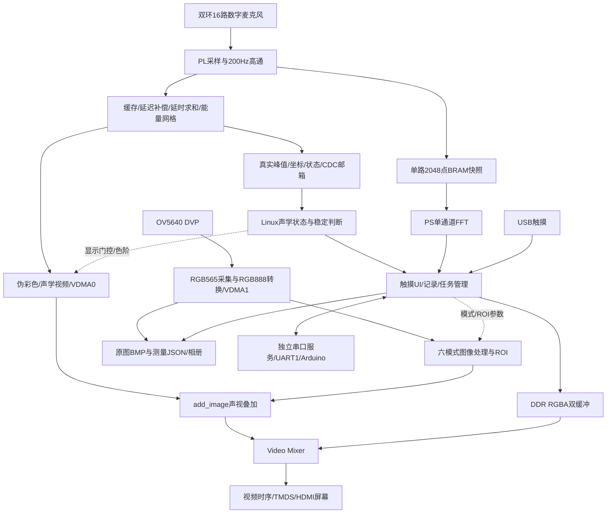
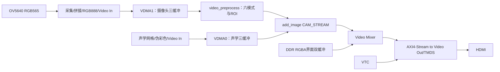

# 声视融合检测系统：设计报告写作事实底稿

> 版本日期：2026-10-31，Asia/Singapore。用途：交给未参与开发的写作模型，独立撰写嵌赛设计报告。
> 本文汇总用户确认、当前代码、发布清单和归档验证；编写时未连接板端、未重新测试硬件。所谓“当前”指截至本日期最近已核对的发布记录，不等于此刻在线状态。

## 0. 给写作模型的使用说明

### 0.1 写作原则与证据等级

本文件提供足够的架构、接口、算法、功能、开发过程和结果描述。即使不能打开附带源码，也应能据此完成报告正文；源文件索引用于进一步核查。实物照片、最终结构尺寸和待测指标不能由文字推断生成。

快速阅读：第1～3节为定位、贡献和架构；第4～6节为硬件/算法/软件；第7节确定最终版本；第8～9节提供结果与限制；第10节提供协作技能；第11～15节提供报告框架、短稿、图表/文献及可直接使用的写作提示词。

| 标记 | 含义 | 可采用的措辞 |
|---|---|---|
| 配置/代码 | 源码、BD或参数已明确 | 采用、配置为、实现了该逻辑 |
| 离线验证 | 仿真、主机测试、伪终端、实现报告 | 在所列模型/版本/条件下通过 |
| 板端记录 | 有历史板端日志或发布核验 | 在该次板端验证中观察到 |
| 用户观察 | 用户对真实画面、触摸、动作的反馈 | 现场测试表明、用户确认；保留测试条件 |
| 待测 | 缺少统一条件下的量化结果 | 待测、待标定、后续验证 |
| 假设 | 现象支持，但尚无直接证据 | 可能、优先排查方向；不写成确定根因 |

不要把实现、离线通过、实物验证和性能定型合并为同一个“已完成”。当前项目是持续集成的样机，功能较完整，仍有明确的工程收口事项。

### 0.2 最重要的事实边界

1. 原项目已有阵列采集、延时求和及声视显示基础。不能把这些基础算法、商业开发板或厂商IP写成本队原创。
2. 当前视觉功能是像素级图像处理和ROI联动，没有已交付的深度学习目标识别或设备故障分类模型；Sobel不在当前六种模式中。
3. 声源ACTIVE表示当前能量门控有效，不等同于判定声音异常或识别故障类型。
4. 单麦FFT提供该通道的主峰候选，没有与空间热点分离绑定；显示位数不是测量精度。
5. 网格能量是未标定计数；没有校准的声压级dB SPL、检测SNR或概率置信度。
6. 抓拍是摄像头原图与同次请求的软件测量记录；不是最终HDMI截图，也不保证相机、定位和FFT硬件严格同帧。
7. 当前声学开关控制Linux侧显示和定位有效性，未停止麦克风采样或PL计算，不能据此声称降低PL功耗。
8. 手动夹取已改用最新有效实时坐标；自动夹取、自动跟踪及跟随ROI仍依赖稳定位置。不要沿用“所有夹取必须stable”的历史规定。
9. 机械臂通过区域任务与独立控制器联动，没有已证实的三维测距、路径规划、视觉抓取位姿估计或夹持成功传感闭环。
10. 2026-10-31使用条件式UI看门狗，旧的开机固定重启UI逻辑已删除；看门狗是恢复措施，不表示显示失步根因已解决。
11. 最新板端摄像头为降频、水平翻转变体，PL也做了热图与坐标水平翻转。根目录原工程与常规摄像头配方不能直接代表最终发布状态。
12. 本文件不包含密码或私钥；写报告的请求不构成连接设备、修改镜像、校准或驱动机械臂的授权。

## 1. 项目定位与实际完成范围

### 1.1 名称和目标

用户最初构想名称为“基于FPGA的声-视融合异常检测与自主复检系统”。报告可沿用该作品方向，正文将已完成内容准确表述为：

**基于ZYNQ-7020的便携式声源可视化定位、视觉辅助处理与机械臂区域联动检测平台。**

目标是把可听声源的空间分布叠加到摄像头画面，帮助人员确定发声区域，并通过触摸界面完成参数调整、测量记录和外部机械臂操作。工业设备异响排查、现场辅助巡检、产品运行声音观察和教学实验是应用方向，尚无特定工业工况的正式验收数据。

“自主复检”目前对应自动跟踪、声触发区域动作及反馈接口的系统基础。抵近后再次测量、比较复检结果并给出故障判定的完整流程仍可作为扩展，不能写成已经实现。

### 1.2 当前功能清单

| 功能 | 实际内容 | 状态与边界 |
|---|---|---|
| 声源定位 | 双环16麦、延时求和、64×36能量网格 | 已实现；特定条件下热点跟随获用户确认，物理精度待测 |
| 背景抑制与显示 | 200 Hz高通、静音门限/滞回、动态色阶、时间平滑 | 已实现并有对照；效果依赖场景和校准 |
| 位置状态 | 实时/滤波坐标、稳定判断、有效性与数据年龄 | 已实现；非概率置信度，软件读取非严格原子 |
| 主峰频率 | CH0高通后2048点FFT | 已接入UI，2 kHz读数获确认；不是热点绑定频率 |
| 实时视频 | OV5640、1280×720、DDR缓存及HDMI输出 | 已运行；当前保留摄像头降频变体 |
| 图像处理 | 原图、灰度、二值化、亮度偏移、反相、移位增益 | 六选一；灰度/二值等不等同目标识别 |
| 区域处理 | 全屏、手动ROI、稳定声源跟随ROI | 已实现；矩形大小可调 |
| 触摸界面 | 顶栏、半透明侧栏、底栏、抽屉、设置和机械臂窗口 | 多轮实物确认；USB枚举仍受实际启动/供电条件影响 |
| 抓拍 | 摄像头原图BMP、配套JSON、160×90缩略图 | 已实现并有成功记录；预检会拒绝采集错误状态 |
| 相册 | 快速抽屉、分页/滑动、详情、普通文本详细数据 | 已实现；仍可能触发公共显示异常，需条件恢复 |
| 机械臂 | 手动/自动夹取、12区跟踪、测试动作接口 | 软件已部署；不同功能的实物验证范围分别记录 |
| 温度与关机 | XADC读取、温度提示、确认后正常poweroff | 已实现；提示阈值不是器件工作上限证明 |
| UI恢复 | 特定SOF速率异常下正常停启UI | 已部署；覆盖已观察模式，非通用黑屏检测 |
| 大模型技能包 | UART接收诊断、回放、C前后对照及报告案例 | 已构建；30项离线测试、独立解压重建通过 |

## 2. 原项目基础、本次贡献与创新表述

### 2.1 参考工程身份

- 本地参考：`upstream_reference/ZYNQ-based-acoustic-camera`。
- 从本地Git读取的来源：`https://github.com/wzwyz/ZYNQ-based-acoustic-camera.git`。
- 本地参考提交：`fe725b6882e491c85ea2ff42e0774adebc58306c`。
- 参考目录包含FPGA、HLS、ARM代码、Vivado工程及Qt上位机材料。本项目当前板端UI是自编C/RGBA界面，不能因参考目录存在Qt就写成当前使用Qt。
- 本底稿已核对公开仓库入口；本地参考提交以上述哈希为准，未展开原许可证审核。正式开源交付应保留对应来源。

### 2.2 继承与新增

| 继承的基础 | 本次主要适配/扩展 |
|---|---|
| 多麦克风接收与声学相机基本数据流 | ICS-43434左声道接收修正，16路双环几何与通道映射适配 |
| 延时求和、样本缓存、能量网格 | 46.875 kHz与64×36配置、正确外环延迟映射、200 Hz高通 |
| 摄像头、VDMA、VTC、伪彩色与叠加 | 从PS裸机迁移至Linux，修正初始化和传输启动流程 |
| 厂商处理系统、视频和存储IP | 自定义状态适配CDC、UIO控制、单路样本快照、六模式ROI处理 |
| 原有声视显示思路 | 动态显示控制、稳定判定、触摸UI、RGBA Mixer双缓冲、抓拍与相册 |
| 外设接口能力 | 独立机械臂服务、任务/回包管理、手动与自动策略、UART接收修复 |

可将创新集中在“声源引导ROI”“面向显示及控制的稳定化处理”“检测、交互与执行联动”的系统实现。不要使用“首次提出延时求和”“原创声学成像算法”“全新多模态识别网络”等表述。

## 3. 总体架构与软硬件分工

### 3.1 划分依据

持续、高吞吐、时序敏感的采样、声学和像素运算放在PL；状态性、交互性和策略性强的功能放在PS/Linux。Linux生成UI而不接管整路摄像头软件渲染；机械臂由独立Arduino控制器执行动作。



图为功能框图。VDMA和Mixer经AXI互连访问PS侧DDR；高通旁路采集仅取一路，不代表将16路原始数据全部搬到PS计算。

### 3.2 三类信息的关系

- **视频数据流**：摄像头/声学图像经PL与DDR送到HDMI，保持流式处理。
- **控制与状态流**：AXI寄存器、UIO、本地Socket和状态文件，用于模式、阈值、位置有效性和操作任务。
- **记录与动作流**：原图/测量写入EXT4；机械臂命令及结果由串口事务管理。

它们更新节奏不同。显示、抓拍关联和机械臂位置策略均不能因此被描述为统一的硬件同帧闭环。

## 4. 硬件事实

### 4.1 主控、外设与供电

| 项目 | 已知配置 | 备注 |
|---|---|---|
| 器件 | ZYNQ-7020，工程目标`xc7z020clg400-2` | 取自XPR及最新实现报告；用户提过器件丝印I，温度等级需以最终完整料号核对 |
| 主控板 | ZYNQ小系统开发板 | 板卡资料在`doc/`，不把商品开发板写成本队自研PCB |
| PS | ARM处理系统运行Linux | BD CPU时钟配置约666.67 MHz，不是本次性能实测 |
| 存储 | 板载DDR与SD卡 | DDR存放视频/UI；SD保存系统、配置和照片 |
| 麦克风 | ICS-43434，16个，3.3V，LR接地 | 独立SD，共用SCK/WS，接收24位有符号左声道数据 |
| 摄像头 | OV5640，8位DVP，当前1280×720 RGB565 | PL扩展为RGB888；原图不是Bayer RAW |
| 显示/触摸 | HDMI视频、USB触摸 | USB接PS Host；不把USB触摸画成PL直接解析 |
| 机械臂 | 独立Arduino控制器 | 主控UART1输出任务；机械臂具体型号、自由度、夹持传感器未在本文确认 |
| 电源 | HJ-28UPS/18650模块，用户给定额定5V/3A | 额定值不是整机实测功耗或启动裕量 |
| 屏幕/风扇 | 用户给定屏幕最高约1A，风扇5V/0.8A | 未提供完整动态负载测试 |
| 麦供电 | 用户已采用开发板3.3V给麦板供电 | 与各非隔离信号模块共地 |
| 散热 | 散热片，后续加入风扇 | 早期曾超过90°C，近期记录多为约61～65°C；不是统一环境温升曲线 |

机械布局以双环阵列与摄像头相对位置固定为基础。最终外壳、支架、整机尺寸、重量、CAD、散热风道和结构强度尚无完整定型证据，不补造数值或图纸。

DDR具体芯片型号与容量需按板卡资料核对，不从BD中的可寻址窗口大小反推出物理容量。

### 4.2 阵列几何与通道顺序

内环半径25 mm、外环50 mm，各8麦。以下方向使用原阵列图视角：右为+x、下为+y；不直接等同最终摄像头显示坐标。用户已确认实际XDC接线，不能沿用早期看错图产生的“接线错位”判断。

| FPGA数据通道 | 环/麦编号 | 原阵列图方位 |
|---|---|---|
| data0 | 内环1 | 右下 |
| data1 | 内环2 | 下 |
| data2 | 内环3 | 左下 |
| data3 | 内环4 | 左 |
| data4 | 内环5 | 左上 |
| data5 | 内环6 | 上 |
| data6 | 内环7 | 右上 |
| data7 | 内环8 | 右 |
| data8 | 外环1 | 右 |
| data9 | 外环2 | 右上 |
| data10 | 外环3 | 上 |
| data11 | 外环4 | 左上 |
| data12 | 外环5 | 左 |
| data13 | 外环6 | 左下 |
| data14 | 外环7 | 下 |
| data15 | 外环8 | 右下 |

两环编号起点不同。外环延迟对应反序的内环方位，再按半径比放大；详见下一节。后期为配合摄像头水平翻转，显示列地址和输出热点横坐标同时翻转；这不改变上述物理接线。

### 4.3 接口关系

- 麦克风：16路SD输入；FPGA输出共用3 MHz SCK及46.875 kHz WS；LR=0选择左声道。
- 摄像头：D[7:0]、PCLK、HREF、VSYNC进入PL；SCCB通过PS GPIO控制。当前SCL/SDA使用EMIO对应GPIO54/55，即bank2 bit0/1。
- 显示：Video Out和DVI/TMDS发送逻辑输出至HDMI。
- 机械臂：UART1经EMIO引出，TX为F17、RX为F16，已交付协议为9600/8N1、无软硬件流控。UART0调试控制台为115200，两者不要混写。
- 触摸：Linux evdev输入；识别设备能力，不固定`event0`。曾识别OpenWare Multi-Touch-V5000（222a:0001）。
- 温度：通过IIO读取片上XADC温度，无需把外部麦克风或摄像头数据接入XADC。

供电试验曾发现屏幕触摸USB可让开发板反向上电，电池/电脑/屏幕不同组合影响触摸工作；最终VBUS隔离、启动电压波形及电源裕量未验收。可写模块化便携供电方案，不写成已通过反灌防护和续航验证的产品电源设计。

## 5. PL算法、视频链路与接口

### 5.1 声学接收和采样时钟

`sensors`使用30 MHz分频基准，产生3 MHz SCK和46.875 kHz WS：`Fs=SCK/64=46875 Hz`。在WS下降沿对齐LR接地的左声道，保留I2S的一位延迟，再在SCK上升沿接收24位样本。16路组成384位总线。

早期只焊接内环8麦时对未接通道屏蔽；之后恢复`sensors`和`buffer_ctrl`的16路有效输入，外环全部接入。当前不能按8麦版本写最终配置。

### 5.2 延时求和、插值与网格

参数为16路、64×36=2304个扫描点、声学时钟210 MHz、采样率46.875 kHz。每个采样间隔约4480个声学时钟周期。保留约4064个采样的滑动能量窗，名义时间约86.7 ms；该时间不是系统端到端响应实测值。

延迟表以麦克风坐标、扫描方向和采样率计算。已有生成记录采用声速343 m/s及参考工程默认60°对角视场假设；尚未作为实际镜头标定结果。

其方向模型可写为 `tau_m(q)=Fs * dot(r_m,u_q)/c`。为实现缓存读取，将各通道相对延迟减去公共最小值，拆成整数地址与小数插值权重，再对齐求和、计算滑动能量。

当前关键修正为：

```cpp
addr_signed[i+8] = addr_signed[7-i] << 1; // i=0..7
```

它在有符号几何延迟上处理外环方位和半径比，之后才求共同最小值与RAM地址，不能解释为把最终RAM地址翻倍。延迟采用Q5小数、两相邻样本插值；保持原接口和固定11级调度约定，HLS流水II=1。HLS的360 MHz综合目标用于调度，不是板上实际运行频率。

`buffer_ctrl`管理样本与延迟读取，HLS `delay/inter/calculate`及`vram_ctrl`等协同处理。`calculate`使用并行加法树及定点运算；能量输出不是物理声压单位。

64×36是计算网格；在1280×720显示中每格对应20×20像素。网格数量、像素块大小、插值位数均不能直接换算为已实现的角度精度。

### 5.3 200 Hz高通

`sensors → acoustic_hpf_200 → buffer_ctrl`；同一输出有效信号送`buffer_ctrl`和`vram_ctrl`，同时旁路进入单路采样模块。

- 16路一致的一阶归一化双线性高通，Fs=46875 Hz，名义截止约200 Hz。
- 系数`B=27740/2^20`，内部状态保留12位小数；最终24位输出做饱和。
- 首样本初始化状态并输出零，避免偏置带来的启动脉冲。
- 乘法部分积、舍入和饱和分级，保持数值模型对应关系。
- 开启与旁路均为6个Aclk周期延迟，最短输入间隔7周期。
- MODE bit16=0开启，1旁路；旁路时滤波状态继续跟踪输入。

它抑制直流和部分低频背景，不等同于完成16麦幅相校准，也不证明所有低频/远距离问题都已解决。

### 5.4 真实定位状态和CDC

`acoustic_result_adapter`在声学域扫描网格，求该次网格峰值及索引，扫描末点将数据保持到邮箱；请求toggle经两级同步进入100 MHz AXI域，目的域取样并返回应答。源端在应答前保持多位负载不变，忙时记录overrun。

控制接口中的位置、峰值、valid/overrun等已接真实声学结果，不再是早期全零常量。`confidence`字段当前复制峰值，属于兼容字段，不能写成概率或经标定的定位置信度。CONTROL中的enable没有实现为PL时钟/算法门控，Linux完成其逻辑效果。

声学邮箱的一组负载通过握手跨域，不代表PS多次独立读寄存器具有硬件原子锁存。当前软件通过重复读取做一致性检查，但没有充分的结果序号/心跳来证明PL持续产生新结果；不能声称完全排除ABA或冻结旧结果。

麦克风样本束在完成信号同步后使用，约束保留稳定窗口和路径上限。对握手同步器仅首级设置异步入口例外，级间仍做时序检查；不是将全部跨域路径一律false-path。

### 5.5 视频、热图与UI合成

最终功能连接关系：



摄像头`axi_vdma_1`基地址0x44A00000，声学`axi_vdma_0`基地址0x43000000。摄像头MM2S先进入`video_preprocess`再进入`add_image`，叠加后进入Mixer。当前版本不是摄像头直连HDMI的临时排查版本。

两路VDMA各有S2MM/MM2S，连同Mixer UI内存读接口经同一AXI互连及HP0协议转换器访问DDR。HP0配置64位、150 MHz。曾修正AXI3/AXI4边界的WID连接问题；不将有该故障的历史tone-v3位流作为最终正常版本。

`add_image`为自由运行核，alpha=0时仍消费两个输入流；不能通过停掉声学MM2S实现关闭热图。Linux逻辑开关和alpha控制让摄像头继续显示，流数据仍须供应。

### 5.6 图像预处理IP

`video_preprocess`为RGB888单像素流处理，支持原图、灰度、二值化、亮度偏移、反相及移位增益。灰度使用整数加权近似；二值阈值0～255，默认128；亮度偏移-255～255后逐通道限幅；增益档位÷4、÷2、×1、×2、×4。

模式互斥，框内处理、框外保留原图。提供矩形ROI、区域像素统计及亮像素计数，可由软件计算亮像素占比。统计量不是目标类别或缺陷检测正确率。

软件写完整shadow参数后COMMIT，IP在被接受的SOF帧首应用，带配置穿过流水线。提供版本、能力、活动参数和应用序号供软件确认。当前工具使用协议3；旧README中的协议2属于历史。

### 5.7 单路样本快照

`acoustic_capture`从高通后16路总线中选一路，采2048个signed24样本，以符号扩展signed32存入片上BRAM，再供PS读取。快照通过请求/完成握手及分域复位处理，不反压原定位链路。它不是16路连续录音DMA。

### 5.8 AXI地址、时钟和DDR配置

| 模块 | 物理基地址 | 用途 |
|---|---|---|
| add_image | 0x40000000 | 声视叠加参数 |
| color_mapping | 0x40010000 | 颜色阈值 |
| axi_gpio | 0x40020000 | GPIO控制 |
| acoustic_capture | 0x40030000 | 单路BRAM样本 |
| video_preprocess | 0x40040000 | 模式、ROI与统计 |
| 声学VDMA0 | 0x43000000 | 声学帧读写 |
| 摄像头VDMA1 | 0x44A00000 | 摄像头帧读写 |
| ExtremalSearcher | 0x44A10000 | 声场空间极值 |
| acoustic_camera_ctrl | 0x44A20000 | 声学状态与逻辑控制请求 |
| Video Mixer | 0x44A30000 | 主视频/UI合成 |
| VTC | 0x43C10000 | 显示时序 |

不同发布版地址兼容仍需核对身份，不能只凭本表向未知位流写寄存器。

| 时钟/数据节奏 | 配置 | 用途 |
|---|---:|---|
| PS FCLK0 | 100 MHz | 部分AXI控制、视频采集侧 |
| PS FCLK1 | 150 MHz | 视频读出、VPP、Mixer、HP0访问 |
| 声学Aclk | 210 MHz | 高通、定位、缓存、采样快照 |
| 麦分频基准 | 30 MHz | 生成SCK/WS |
| SCK / WS | 3 MHz / 46.875 kHz | 数字麦串行时序/采样 |
| 显示像素/发送 | 74.25 / 371.25 MHz | 视频与TMDS输出 |
| 相机PCLK | 摄像头外部源同步输入 | 当前降频后实际频率待示波器复测 |

声学帧缓存起始0x01100000，摄像头起始0x02100000，各3帧RGB888。1280×720×3=2764800字节/帧，行步长3840字节。摄像头3个地址为0x02100000、0x023A3000、0x02646000。

UI缓冲为0x03000000、0x03400000，各槽4 MiB，总预留8 MiB，画布1280×720×4=3686400字节，位于预留no-map DDR，与摄像头缓冲不重叠。DDR缓存与常规Linux堆内存需分开描述。

## 6. Linux软件系统与产品交互

### 6.1 软件架构与进程关系

核心以C语言实现，采用独立服务、Unix域Socket、原子替换的状态文件和后台子进程。当前不是Qt/LVGL应用，也不是浏览器/云端渲染方案；不应把此前讨论框架选型写成已经引入框架。

| 功能 | 程序/接口 | 输入与输出 | 实现要点 |
|---|---|---|---|
| 视频启动 | `video_pipeline_init` | GPIO/SCCB、HLS/VDMA/VTC/Mixer；`/run/video-pipeline.state` | 当前板端使用降频/翻转包装变体 |
| 声学显示 | `acoustic_display_control` | 声场极值、开关；色阶/alpha及`/run/acoustic-display.state` | 叠加alpha的唯一日常写者 |
| 声学状态 | `pl_control_daemon` | 真实寄存器、显示门控；`/run/pl-control.sock` | 50 ms采样、状态融合、稳定窗口 |
| 主频工具 | `acoustic_frequency` v2 | BRAM单路样本；JSON | 去均值、Hann窗、FFT与峰值插值 |
| 主频发布 | `acoustic_frequency_feed` | 采集工具输出；`/run/acoustic-frequency.state` | 与UI分进程、出错有界重试 |
| 触摸UI | `video_status_panel` | Socket/状态文件/IIO/evdev；RGBA双缓冲 | 当前v30，目标5 Hz |
| 图像控制 | `video_preprocess_control` | 模式/阈值/亮度/增益/ROI；配置确认 | 严格身份与协议3校验 |
| 抓拍 | `camera_snapshot` v3 | 摄像头DDR、测量；BMP+JSON+缩略图 | 采集预检、复制保护、成组提交 |
| 相册 | `camera_album` v2 | SD文件；有界列表/详情数据 | 后台读取、校验及缩放 |
| 机械臂 | `robot_control_daemon` v7 | `/run/robot-control.sock`、ttyPS1 | 独占UART、任务状态与自动策略 |
| 显示只读诊断 | `video_display_diag` | 已暴露的视频状态 | 不消费UI持有的Mixer完成事件 |
| 条件恢复 | `video_ui_watchdog` v2 | 真实VPP SOF、UI身份、Mixer/VDMA | 条件满足后正常停启UI |

SysV init管理启动。视频服务为S95，机械臂服务为S98，部分声学/频率/UI服务为S99；就绪检查和有界等待比单纯数字顺序更重要。不是systemd单元配置。

### 6.2 从裸机迁移与启动状态机

原PS裸机负责摄像头初始化、HLS参数、VDMA/VTC和视频启动。这些工作已移入Linux用户态控制程序，不能只保留UI而假定摄像头硬件会自行开始。

当前启动主流程：硬件身份核对与GPIO准备 → Mixer主视频层准备 → HLS默认参数 → 两路VDMA配置及S2MM启动 → 摄像头SCCB配置/开流 → 观察采集帧 → 两路MM2S → VTC → 发布运行状态。失败阶段及返回码分别记录。

移植期间处理过PS GPIO时钟、GPIO bank映射、SCCB ACK/引脚状态、VDMA旧VSIZE提前触发、帧地址/步长、写1清零状态和VTC控制配置等问题。最终以裸机正常寄存器基线和Linux实测逐层比对，而不是把一切故障归于Linux驱动。

VDMA行/帧错误具有粘滞和指针锁存行为，但不能因此一概忽略：先区分历史残留与新发生的错误，记录、限次对照并观察帧推进。近期原速采集清错后可在0.5秒内复发，属于需要处理的新错误证据。抓拍程序不在循环中自动清错掩盖问题。

### 6.3 UIO身份与硬件访问

通过`/sys/class/uio/uio*`中的名称、映射物理地址和尺寸定位对应`/dev/uioN`，不固定uio0。自定义模块进一步检查硬件ID、版本和能力，再mmap读写。相应软件使用互斥锁协调同一硬件的访问。

UIO解决设备身份及用户态寄存器访问，不自动提供相机初始化、DMA缓冲所有权、帧原子性或Cache一致性保证。部分历史空间极值访问使用只读`/dev/mem`，不要写成所有硬件访问均已统一为内核驱动。

### 6.4 静音门控、动态色阶与开关

显示服务基于显式静音校准结果建立门限，开启与关闭使用不同阈值和连续次数，结合上升/下降时间平滑及色阶限速。动态颜色依据当前声场极值及对比度；低对比度场景采用稳定化处理。原固定色阶引起随音量全红/消失，调整后获得用户改善反馈，但固定色阶A/B也显示部分面积波动来自输入声场本身。

曾使用热点下限比例0.65、红色核心比例0.95，用户确认热点及红核缩小、跟随正常。这些是能量映射参数，不是热点面积或红色像素比例的实测值。

校准在用户确认安静后执行，不开机自动校准；避免把正在播放的声源纳入底噪。源码模板`noise_peak=0`不是板端实测结果；早期8麦25120、16麦90951和高通场景9461分别属于不同阶段，不得混成最终统一基线。当前环境需要保存/重测自己的配置。

开关流程：UI请求enable/disable → daemon读改写请求位 → 显示服务观察并写入有效alpha → 回读确认并发布状态 → daemon确认应用 → UI更新。OFF清空定位窗口，ON重新积累；同次开机重启daemon保留开关，重启默认ON。不因关闭识别而关闭PL、麦克风、FFT或视频。

### 6.5 定位状态融合和坐标体系

软件用50 ms单调时钟节拍读取，在最多500 ms、10个观测中取坐标中值；初始规则要求至少8个点、跨度至少350 ms、80%在半径3格内、最新点属于该簇，候选驻留至少300 ms。它们是策略参数，不是测得的物理精度或端到端延迟。

状态包含disabled、enable_pending、quiet、unavailable、read_unstable、acquiring、moving、stable等。来源过期/无效与静音分开；来源失效不能冒充已确认静音。状态提供raw/filtered坐标、position_valid、观测年龄和读取质量。

坐标关系：

- 硬件兼容ABI：`legacy_x=2*col+1`、`legacy_y=2*row+1`，保留在旧128×72范围内的奇数中心。
- Linux零基网格：`col=(legacy_x-1)/2`，`row=(legacy_y-1)/2`；范围0～63、0～35。
- 显示格中心：`pixel_x=20*col+10`、`pixel_y=20*row+10`。
- 最新水平翻转：显示列`63-old_col`，硬件奇数中心`128-old_legacy_x`；不是`127-old_legacy_x`。
- 2026-10-30已在PL同时翻热图与输出坐标，UI、跟随ROI和机械臂消费者不应再重复翻转。

这些是显示/网格坐标，尚未完成镜头畸变、声视外参、角度或三维距离标定。稳定状态也不是“已识别具体目标”。

### 6.6 单通道FFT与显示有效性

默认CH0、高通后signed24、2048点、声明采样率46875 Hz。每块约43.69 ms，原始频点间隔约22.89 Hz。PS执行去均值、Hann窗、FFT和谱峰插值，当前搜索300～10000 Hz，输出候选、幅值相关统计、削顶和序号等。

主频采集与UI分进程，目标约每200 ms更新，不保证硬实时5 Hz。UI要求候选有效、版本/参数匹配、无削顶、数据不超过约1秒且声音状态有效，才显示当前频率。采集工具的`quiet_gate_fused=false`表示工具自身不做这层融合；UI消费者仍使用现有声音门控。

用户短时播放2 kHz时确认读数准确，但没有多频点、已校准声源与时钟条件下的误差统计。主峰可能是谐波或环境音，不是已识别的故障基频；频谱突出度不等于已校准的SNR。

### 6.7 UI布局、字体、触摸与双缓冲

- 顶栏：AC-16 ARRAY、MODE: DELAY-SUM、SOUND、XADC TEMP、UPTIME等低频变化/高优先级信息。
- 右侧测量卡：实时坐标、稳定状态/坐标、网格能量峰值、真实单麦主频和机械臂状态。原始信号峰值已从产品侧栏移除；部分JSON兼容字段仍为null。
- 侧栏可通过窄按钮收放，半透明；图标用几何描边绘制并保留触摸热区。
- 底栏顺序：声学开关、图像模式、区域选择、中央抓拍、执行、相册、设置。执行位于相册左侧。
- 图像模式为六选一抽屉；区域选择为全屏、手动ROI、跟随ROI的竖向抽屉；其余参数放设置页。二值与亮度设置有滑块和加减微调，按应用提交。
- 相册打开右侧快速抽屉；编号和启动后时间合并，去掉重复BMP+JSON及诊断性小字。详细数据使用普通文本展示，文件仍为JSON。
- 字体使用离线生成的Noto Sans SC中文字形及DejaVu数字字形，直接在C/RGBA画布混合；没有要求运行时加载Qt/FreeType。
- 触摸按设备能力识别并归一化到1280×720，处理短按、拖动及滑动；断线、多指、无效坐标和SYN_DROPPED取消当前手势，支持设备重接发现。

双缓冲先绘制后缓冲，写入完成并发布，再等待Mixer完成事件后复用。当前实现用两个新的完成事件退役以适配流水线；运行期常规写入不再每帧全量读回，只在两个槽初次使用时完整校验，保留诊断对照入口。UI目标5 Hz与HDMI/摄像头帧率是不同指标。

当前产品UI已按用户要求精简；报告中的来源边界和诊断说明不应擅自塞回产品界面。

### 6.8 图像控制和跟随ROI

模式：0原图、1灰度、2二值、3亮度偏移、4反相、5移位增益。未指定参数继承已生效配置。每次写完整参数，校验范围、读回shadow，COMMIT一次并检查pending、APPLY_SEQ及ACTIVE匹配。

手动ROI由触摸矩形选择；跟随ROI以稳定位置生成用户可调大小的矩形，限制画面边界，并采用移动死区、限步和短时保持以减少抖动。静音、OFF或未知状态撤去跟随处理，保留原图，避免把旧框或整个画面误设为处理区域。

这是声源引导的局部像素处理，不是自动识别物体轮廓或语义分割。

### 6.9 抓拍与相册

保存位置为`/var/lib/acoustic-camera/captures/shot-.../`，每条记录包含：

```text
camera.bmp             1280×720、24位、未压缩原图
measurement.json       同次请求的测量和诊断信息
thumbnail.bmp          160×90派生缩略图
thumbnail-v1.meta      可再生成缓存的校验信息
album.seq              新记录的持久序号
```

原图来源为摄像头VDMA1的S2MM DDR，位于`video_preprocess`、热图和UI之前；保留摄像头ISP输出，不含后级图像模式/热图/UI。BMP采用BGR24/top-down，约2.64 MiB。缩略图约42.24 KiB，通过8×8面积平均从CPU已取到的原图副本生成，避免再次访问相机DDR。

抓拍先检查UIO、预留内存、几何、DMA状态、空间及写槽推进；复制过程中检查写槽/错误/时间间隙，两遍比对，失败时重试或拒绝。仍是带保护的best-effort，不存在硬件帧缓冲所有权栅栏；`frame_atomic=false`。

v3/UI新预检每约5秒更新，要求观察到两次干净写槽变化；失败撤销ready，恢复后自动复检，补全S2MM EOLLateErr(bit15)等错误检查。程序不自动清错。

图片和测量先写私有临时目录，文件与目录同步后rename发布，成功后才显示SAVED；未完成目录不计入相册。JSON记录启动标识、单调时间、采集关联、位置、能量、频率、温度、数据有效性和校验信息。RTC历史未校准，不把启动后时间当作真实日期。

相册后台按需读取缩略图；打开详情才校验原图并生成640×360预览，显示测量摘要或普通文本详情。无需JPEG/PNG解码库；主要开销为SD读取、CRC、缩放和IPC。后台任务可取消，拒绝过期页面结果，历史原图不自动改写或删除。

### 6.10 机械臂协议与当前策略

生产通信为`/dev/ttyPS1`、9600/8N1、二进制小端、无软硬件流控。基本帧：

```text
Linux → Arduino: AA 55 01 task_lo task_hi region 0D 0A
Arduino → Linux: AA 55 02 task_lo task_hi status 0D 0A
```

区域1/2/3为约定料位。当前TYPE02结果00表示控制器动作流程结束，01失败，02执行中，03区域无效；早期草案把02写成“忙”，应以已交付协议为准。扩展响应按TYPE确定固定总长，例如TYPE26为130字节，TYPE28为33字节，负载可包含AA55或0D0A。当前串口帧没有LEN/CRC；不能将EEPROM CRC当作串口校验。

图像三分区为列0～20、21～42、43～63，经过`/etc/robot-regions.conf`映射到机械臂料位。文件当前是1→1、2→2、3→3，默认夹取总等待30秒。10月24日有三料位实物动作与方向确认；10月30日相机/热图翻转后、10月31日手动策略更新的最新完整动作联调尚无本轮确认，不能把旧动作测试自动扩展到全部最新路径。

| 模式 | 当前行为 |
|---|---|
| 手动夹取 | 使用最新有效raw坐标，不要求stable；需声学ON且已应用、active、观测≤150 ms、合法区域、无其他活动任务等。确认窗口10秒内持续更新；暂时无声保留窗口、禁用确认。发送时服务独立重读最新区域，UI区域仅为提示 |
| 自动夹取 | 需稳定目标在同区域驻留1.5秒，显式开启自动开关后触发；连续声源只触发一次，完成后需2秒新鲜QUIET重装，再有3秒冷却和新驻留 |
| 自动跟踪 | 使用稳定位置映射已标定4×3共12区，包含过滤、边界滞回、连续观测和最小请求间隔；静音/无效时保持，条件恢复后再跟随 |
| 测试动作 | 独立测试页，显式确认开始、次数/连续选项及停止后续动作；与其他自动任务互斥 |

服务独占UART，区分组帧、TYPE/ID匹配、接受/进度/最终结果；采用nonce去重、发送前持久化及未决任务管理。启动不主动发应用命令，自动开关重启后关闭。

最新夹取超时：30秒未得最终结果进入“结果未知”；提示保留5秒，随后转本地READY，清除连接确认和自动模式。此过程不构造成功、不证明机构已停止、不发送停止/探测/重试或新动作；过期旧回包按规则忽略，配置/持久化故障仍闭锁。

打开串口不证明Arduino在线；历史“完成”也不是持续在线心跳。停止后续动作或切OFF不等于机械急停。不能把状态00解释为有传感器证明夹住物体。

### 6.11 温度、关机与条件恢复

XADC每约1秒通过IIO读取温度，按`(raw+offset)*scale`转换为毫摄氏度。UI的WARM/HOT策略分别为90/95°C；它们是软件提示阈值，不是芯片额定工作温度或长期可靠性验证。

设置页确认后通过`posix_spawn`请求`/sbin/poweroff`，由Linux init正常关闭服务和同步文件系统；不采用强制关机参数。系统关机不等同切断所有电源，更不构成机械臂硬件急停。

当前独立看门狗规则：

- 每秒只读采样VPP成功握手SOF计数，首样本建立基线。
- UI身份有效、Mixer layers=3、相机读写通道运行且无错时，连续3个完整区间为72～90次/秒才请求恢复。
- 正常节奏、采集错误、UI关闭/更换、计数复位或采样异常均清空连续累计；处理自然32位回卷。
- 服务锁内复查UI和监控进程身份，正常停UI，确认图层恢复后再启动；停止失败不强杀、不继续拉起。
- 尝试结束冷却10秒，再重新累计；无恢复次数上限。手动停UI也停监控，晚到请求不能复活手动关闭的UI。
- 开机只启动UI一次；旧“等待后固定重启一次”已删除。不额外归档故障历史日志，只覆盖`/run`运行状态。

看门狗不读取UI持有的Mixer ap_ctrl/ISR完成事件，不修改摄像头/VDMA/VTC，也不发机械臂命令。已知异常曾在约80 SOF/s时发生，UI停启后回约60；这个计数不是相机FPS或HDMI物理帧率。没有相同节奏特征、或相机报错的黑屏不会被该规则覆盖。

## 7. 截至2026-10-31的发布身份与复现状态

### 7.1 最近已核对的版本

| 组件 | 版本/身份 | 来源 |
|---|---|---|
| BOOT.BIN | 热图与坐标水平翻转版，SHA256 `afb669a767b0d34bc73041bbc7ad5298cbdf94be8ddc9a4786047caee5a94445` | 10月30日发布及10月31日保留核验 |
| PL bit | SHA256 `6b95c6940c8e246e77e72fc2e6ff66b2e29e0de435d9ee15304e0bfb3b13bfd0` | `diagnostics/20261030/heatmap_hflip/release/system.bit` |
| 实现DCP | SHA256 `9f023c272d618e62adc916f44f87001f7e22a4bca25c7b8b189dea8cbf12b247` | 对应该bit的独立实现 |
| 摄像头初始化器 | `20261030-video-init-half-clock-hflip-v2`，SHA256 `60577766db1820e6d69378b5b5a5fa7d526b0dd90c202ac4acb86021b18a1e57` | 板端降频/翻转变体 |
| UI | `20261031-video-status-arm-live-v30`，SHA256 `209d9a1fb5e0e6537106afec7170bc02c3be8feceb6e3ae88575a5d4570b91a8` | 最新手动实时区域界面 |
| 机械臂服务 | `20261031-robot-control-v7`，SHA256 `d6c8ffb9d60904c8aee90989480cd0917e7645e1e5300b8bdedc6d2990d0f5fe` | 当前手动策略与未知退出 |
| 看门狗 | `20261031-ui-watchdog-v2`，SHA256 `1f6502ecd7747eb3e5efd3fcfc942b33ff210969a1ff2bdc07240207c5908259` | 10秒冷却版 |
| UI服务脚本 | SHA256 `baaf7f80511f8e4d8b5490d3c50d3cf5f5719bafed788fc51fbf7c38ac4bce0d` | 条件恢复、取消固定二次启动 |
| 抓拍/相册 | snapshot-v3 / album-v2 | 10月30日发布，新增诊断与ready修正 |
| 频率/声学状态 | FFT v2、状态daemon v3、显示控制v7 | 来源接口不变，部分早期README正文保留旧记录 |

### 7.2 摄像头最终保留设置

降频变体将0x3035从0x11改为0x21；最后一次水平配置0x3821从0x07改为0x01；0x3820=0x46、0x4740=0x20、0x302C=0x02保持，尺寸仍1280×720。更改的是传感器分频及水平显示方向，HDMI时序不随之改成“半速HDMI”。

预期采集速率约减半，但本轮没有示波器测PCLK/VSYNC；不能填入推算出的精确摄像头帧率。此前在线极性/驱动试验都已回退，不能写成最终采用了2倍驱动或反相PCLK。

### 7.3 正式源码与板端变体必须区分

10月30日翻转bit来自独立工程`<hardware_build>/heatmap_hflip/heatmap_hflip.xpr`及该次checkpoint流程；原主工程两个RTL、BD和XPR被保持为原样。正确翻转候选在`diagnostics/20261030/heatmap_hflip/candidate/`，正式发布在该目录`release/`。

主工程`acoustic_pixel_mapping.v`仍能看到未翻转组合映射。不要仅打开它就判定板端没翻转，也不要直接从它重建后声称得到当前最终bit。最近明确核验的是bit/BOOT身份，本文不提供一个已证明等价于最终bit的统一最新XSA文件名；根目录`system_wrapper.xsa`不能作为身份依据。

摄像头常规配方仍编译原`video_pipeline_init.c`和原速表，板端使用`diagnostics/20261030/camera_hflip/video_init_half_clock_hflip.c`包装变体。再次覆盖rootfs可能丢失当前相机分频/翻转设置。10月31日UI/机械臂/看门狗相关源码已同步VM配方，但没有重新生成完整镜像。

因此，可说明已有分模块构建脚本、校验和与发布记录；在统一收口并从干净环境复跑前，不写成“现有主工程一键构建即得到所有最新板端状态”。UART技能的独立重建通过仅对应技能包本身。

### 7.4 工具、启动和根文件系统

- Vivado / Vitis / HLS使用2026.1，经历过IP升级、HLS配置路径与BD输出产物重建。
- PetaLinux工程位于VM的`<petalinux_project>`。具体PetaLinux发行版、Linux内核和交叉编译器版本应从最终构建环境补齐，不能直接用Vivado版本代替。
- 原initramfs根文件系统已迁移为SD第二分区EXT4；用户曾验证`root=/dev/mmcblk0p2 rw rootwait`及`findmnt /`为ext4。
- SD第二分区约14.5 GiB，曾出现文件系统只有约85～95 MiB，后离线检查并扩展，用户df显示约14G、13G可用。这是该次容量观察，不是存储速度测试。
- FAT启动分区常见BOOT.BIN、image.ub、boot.scr、system.dtb；EXT4存程序/配置/照片。用户态程序更新可独立替换并核验，不需每次重写rootfs.ext4。
- BOOT包括FSBL、bit及启动载荷。10月30日新包仅PL分区不同，其余FSBL、U-Boot、内嵌DTB与启动头逐字节保持；不能把更换BOOT简化为“只是换一个同名bit”。
- USB PHY的MIO8复位已加入FSBL：低20 ms、释放后等700 ms。该措施有触摸枚举成功记录，不能据此保证所有供电条件下USB均正常。

## 8. 可以引用的性能、验证与待测指标

### 8.1 最终PL实现报告的量化结果

以下取自2026-10-30水平翻转版本、`Physopt postRoute`报告，目标xc7z020clg400-2，包含当前调试/测量模块。不是原开源版本或早期8麦版本的数据。

| 指标 | 已用/可用 | 占比或结果 |
|---|---|---|
| Slice LUT | 25603 / 53200 | 48.13% |
| Slice FF | 46470 / 106400 | 43.67% |
| Block RAM Tile | 129 / 140 | 92.14% |
| DSP | 133 / 220 | 60.45% |
| 已占Slice | 11985 / 13300 | 90.11%，不同于LUT占比 |
| WNS / TNS | — | +0.136 ns / 0 |
| WHS / THS | — | +0.036 ns / 0 |
| WPWS / TPWS | — | +1.101 ns / 0 |
| 无时钟/未约束内部端点 | — | 0 / 0 |
| 路由错误 | — | 0 |

现有用户约束下时序通过，但报告仍有27个输入端口缺少input delay，以及7项no_output_delay检查结果（6个HIGH，1个LOW）。不能写成外部摄像头接口已全面时序签核。早期“WNS只有1 ps”属于旧位流，不用于描述这一版；当前也不能只看LUT不到一半就推断PL扩展空间充裕，BRAM与Slice占用已较高。

### 8.2 声学离线验证

- 双环延迟映射：14360组C仿真及C/RTL联合仿真；实际ROM2304格、16路地址/权重、边界与连续流水检查通过。旧源码在新测试中失败，构成有效负对照。
- 双环`delay`单IP HLS估算FF=2023、LUT=1540、BRAM/DSP=0；此为该IP估算，不能当整机资源或最终布线占用。
- 高通：16820组×16路=269120个样本与独立整数模型逐位对照；包括保存ILA数据、极值、舍入、模式切换和饱和。综合网表仿真也通过。
- I2S发送模型→接收→高通链路48帧×16路通过，含复位及模型数据延迟；不代替真实长线电气测试。
- 热图翻转：穷举921600个显示像素及64列热点输出、全部36行、复位/越界，仿真通过。热点适配IP OOC由75 LUT/168 FF变为81 LUT/168 FF，不能由此推断整机只增加6 LUT。

### 8.3 高通静音开/旁路/开板端对照

2026-10-06，同一当时环境、原显示配置及校准不变，每段等1秒后读24次显示状态，间隔250 ms：

| 阶段 | 峰值统计中位数 | 最小～最大 | active次数 |
|---|---:|---|---|
| A 高通开启 | 643 | 396～1130 | 0/24 |
| B 旁路 | 38593.5 | 13996～302194 | 24/24 |
| C 恢复高通 | 690 | 458～1577 | 0/24 |

以A/C中位数平均666.5比较，B统计量约57.9倍。只可表述为该场景背景缩放能量统计下降，不能写成57.9倍定位距离、固定声压降噪增益或每路SNR提升。B仍使用高通状态的基线，active次数不是两种模式分别校准后的公平检测率对比；24次状态读数也不是24个独立ADC样本。

### 8.4 用户观察与环境影响

- 高通及门控/色阶调整后，用户反馈静音无闪色、低音量更稳定，曾在约1米场景也稳定。它们是特定测试条件的观察，不作为有效距离范围或准确率承诺。
- 800 Hz时热点较宽、曾有颜色和边界波动；v6显示策略有一定作用，用户认为至少左/中/右可辨，低频阶段性接受。不能写低频高分辨率或定位全频段一致。
- 约3.2～3.5 kHz的双侧热点对桌面、墙面、人体站位敏感。阵列离开桌面、改变安装后单热点可重复；支持环境反射/安装影响的重要性，尚无唯一根因的完整定量实验。
- 原始SD、signed24及ILA多次采集用于排查通道差异。曾关注data1/data6，未在本文证据中完成故障麦确诊或更换验收，不编造“换麦根治”。
- USB触摸、侧栏收放、六模式/滑块、ROI、抓拍相册等有多轮用户确认；不能据此推导连续运行任意时长都稳定。

### 8.5 最新摄像头、抓拍与显示结果

10月30日，30 cm摄像头线与PCLK/GND绞合不变，降低传感器分频后，约17～314秒多次读取相机S2MM错误掩码为0、写槽轮换。命令行抓拍一次约779 ms、触摸一次约886 ms，计数4→5→6；包含保护重试，是两次样本耗时，不是平均/最坏抓拍延迟。

相册缩略图列表的若干后台构建约10～23 ms，详情后端构建约126～128 ms；另一次出现显示故障时详情构建约228 ms、管道约206 ms。后台时间不等于触摸至屏幕响应，不能择优单个数字当系统指标。

用户确认降频后抓拍、列表、详情、详细数据正常。之后仍出现整屏黑/竖纹，说明采集改善不等于公共显示完全修复。

### 8.6 UART与技能验证

历史配置读取故障：9600/8N1、FIFO水位56，五次查询650字节、0有效帧、5次半包过期。修复区分线上50 ms与主机交付200 ms，保持完整请求期限。

修复后两项只读配置查询接收163字节、4批、2个有效响应，过期/拒绝/忽略为0；观察到56/56/18交付、59/22 ms间隔。该验证不驱动机械臂。

本轮独立技能包：30项离线测试全部通过，冻结前后C解析器与Python模型一致；合成130字节回放旧版0帧、新版1帧，真正主机空闲和总请求超时仍生效。ZIP独立解压后30项再次通过；没有在本轮重测硬件。

### 8.7 必须保留待测的项目

| 指标 | 状态 | 后续应记录的条件 |
|---|---|---|
| 有效定位频段 | 未有统一量化验收 | 单扬声器、频点、距离、声压、背景/反射 |
| 有效定位距离 | 待测 | 固定声源强度、安装、频率及成功判据 |
| 定位角误差/分辨率 | 待标定与测试 | 角度真值、视场/外参、重复次数、统计量 |
| 主频估计误差 | 待多点测量 | 标准源与真实采样时钟，不以显示小数位代替 |
| 摄像头FPS | 降频后待测 | PCLK/VSYNC或可信帧时间，不用VPP计数代替 |
| 热图刷新率 | 待测 | 能量窗/扫描完成/显示更新分别定义 |
| 端到端响应 | 待测 | 声学事件到热点/有效位置/动作各自边界 |
| UI刷新率 | 当前目标5 Hz | 实际负载、丢帧/长尾、相册并发条件 |
| 长期稳定性/冷启动成功率 | 未完成统一矩阵 | 时长、次数、供电、温度和故障定义 |
| 整机平均/峰值功耗、续航 | 待测 | 屏幕亮度、风扇、算法、动作电源计入范围 |
| 机械臂最新闭环成功率 | 待验证 | 当前方向/标定、手动与自动分别统计，物理完成判据 |
| 原开源基线对比 | 缺同条件整机结果 | 硬件、版本、声源、供电、负载和资源范围一致 |

## 9. 调试过程、判断依据与仍未解决的问题

### 9.1 主要开发阶段

| 阶段 | 工作与经验 |
|---|---|
| 裸机/2026.1迁移 | 以原裸机正常工程为基线，完成IP/HLS迁移、输出产物恢复与实现时序调整；裸机JTAG脚本不能在活动Linux下直接运行 |
| Linux控制迁移 | 加入真实状态接口与UIO，移植摄像头/HLS/VDMA/VTC，按寄存器和数据通路逐层验证；不能把UIO节点存在等同视频启动 |
| 根文件系统迁移 | initramfs改SD EXT4并扩容，支持程序热更新与记录持久化；完整重写rootfs仍会覆盖已有程序/照片 |
| 麦接收与阵列适配 | 纠正LR接地的左时隙接收；先适配8麦25 mm内环，再恢复16麦及50 mm外环、反序2倍延迟 |
| 声学稳定化 | 静音校准、滞回、动态色阶、低对比度处理和200 Hz高通；把信号/声场不稳与着色不稳分开 |
| 状态与交互 | UIO身份、稳定坐标、单麦主频、RGBA Mixer、双缓冲、中文触摸UI、ROI和抓拍相册 |
| 机械臂联动 | 基本串口迁移为现行9600协议，区域映射、动作回包、跟踪/自动模式；修复长回包批量交付误判 |
| 视频近期收口 | 长线采集错误与公共输出异常分离；保留相机降频/翻转，配套热图翻转；加入UI条件恢复 |
| 写作与经验交付 | 按企业赛道补充报告框架，构建可独立验证的UART技能包及本事实底稿 |

### 9.2 摄像头绿点与线缆裕量

暗色物体出现绿点，换摄像头和线仍存在；受保护的小份DDR预览确认问题已在摄像头采集数据中，而不是仅在UI/HDMI后端。像素统计呈绿色高位异常线索，但不能仅据此证明某个FPGA引脚损坏。

用户补充线长由21 cm变30 cm；换回21 cm恢复正常，PCLK与一根两端接地的GND配对绞合显著改善。说明新连接条件与问题高度相关，但线长、接触、走线和噪声因素尚未完全单独分离。

曾在线短时试改PCLK极性和2倍驱动，均已回退，期间采集失步需正常重启恢复；第二项受前一次失步干扰，不构成有效驱动强度A/B。新增统一IOB采样级的方案后来暂停，没有作为本次完成项。

近期原速清错后新行/帧错误复发；相机分频后有所改善。降频同时降低DVP速率和DDR写入负载，因此不能唯一归因于线缆。外部I/O delay尚不完整，继续电气/时序观测仍有价值。

### 9.3 整屏黑/竖纹与公共显示通路

关键现象：UI和摄像头一起损坏，但进程、双缓冲和部分上游计数仍前进；正常关UI层后摄像头恢复，重开同哈希UI后完整画面恢复。相册文件读取及CRC可通过；也曾未打开相册就出现异常。

一次现场：UI图层开启时VPP约80 SOF/s；暂停UI CPU刷新约2.5秒仍约80；正常关闭UI后约60，重开同版UI保持约60。摄像头和声学VDMA错误为0，用户确认画面恢复。

Video Out的locked、underflow、overflow、status及FIFO水位没有可读观测接口，不能写成已读到欠流或确认Mixer本体bug。当前优先方向是共享DDR访问停顿、流边界/反压与输出同步，仍属于假设。

全屏RGBA在假设60次/s读取时的纯像素量约221.184 MB/s；这是估算，不是总线实测或饱和证明。降低UI的CPU刷新至5 Hz不等于Mixer只以5 Hz读图。软件已减少全帧读回；看门狗能恢复已知模式，但未根治。

### 9.4 高通、声场与弱声不能混为一个结论

固定色阶后热点仍可忽大忽小，说明动态色阶不是唯一因素；高通显著降低当时背景统计并改善使用反馈。高频双热点又与桌面/人体反射有关。报告应呈现分层排查与多因素边界，而不是写成一个参数解决全部问题。

### 9.5 当前最需要收口的事项

1. 统一正式工程、最终翻转bit和相机降频变体的构建/发布入口，完成从干净环境的整机复现。
2. 补齐外部摄像头时序观测和约束；在最终30 cm连接与供电条件下复测采集裕量。
3. 补充公共显示通路观测，确定失步根因；记录看门狗触发与恢复率，而非仅展示一次恢复。
4. 在最终朝向/机械工作区重新确认区域标定与完整UI动作联动，再测自动跟踪/夹取。
5. 完成定位、频率、时延、功耗、温升、冷启动与连续运行的统一测试矩阵。
6. 定型整机结构与供电路径，补实物照片、尺寸、质量和电源实测。

## 10. 大模型协作与已完成技能包

### 10.1 协作事实与写作角度

用户决定应用目标、器件/接线、测试场景、是否播放/移动声源、图像和动作反馈，并授权实际设备操作；模型辅助分析RTL/C/HLS、生成诊断/测试、修改配置与程序、解释证据及整理交付。不要写成完全无人参与、模型自动完成所有实物验证。

协作关键方法是：问题描述 → 可区分假设的只读证据 → 最小可复现实验 → 对照修改 → 回归与实物反馈 → 提炼适用边界。保存失败和修正轨迹，而不只展示成功代码。

### 10.2 UART首项完整案例

问题是扩展标定长响应超时，而短回包能处理。旧实现把用户态交付50 ms作为半包清除条件；9600/8N1下56字节占58.33 ms，真实130字节回复被驱动分为56/56/18交付，观察到59/22 ms间隔。根因是时间语义混淆，修复为有限的200 ms主机交付阈值，保持TYPE/ID/长度及请求总期限。

历史板端只读查询验证得到163字节、2帧，过期/拒绝/忽略为0。技能封装时冻结旧/新C头文件，使用同一合成轨迹对照：旧版0帧、新版1帧；同时验证真正空闲、噪声、错号、负载内伪标记及完整请求超时。合成负载不冒充实机原始字节流。

当前交付：

```text
skill/
  README.md
  package_uart_skill.py
  manifest-sha256.json
  linux-uart-receive-v1.zip
  linux-uart-receive/
    SKILL.md
    agents/openai.yaml
    scripts/uart_rx.py
    scripts/reference_parser_probe.c
    scripts/verify.py
    fixtures/
    tests/test_uart_rx.py
    references/workflow.md
    references/case-study.md
    references/collaboration.md
    references/evidence/
    validation/
```

30项离线测试、C前后对照、独立解压重建已通过，ZIP含25个文件并带逐文件SHA256。本轮没有串口或机械臂访问，原工程6个受保护文件校验保持。技能不等于PYNQ Skill，本项目没有因赛题推荐而迁移到PYNQ，不能申报相应额外能力。

### 10.3 真实摘录、摘要与可复用模板要分开

技能协作文件保留当前对话可核对的用户提问、模型确认及授权摘录；历史技术链依据源码/日志归纳，未声称包含全部逐字会话。新整理的可复用提示词明确标为模板。写作时不生成虚构模型回答、实验对话或不存在的截图。

本轮还实际遇到Windows旧MinGW对`%llu`格式检查兼容问题，探针改用C99 `PRIu64`后通过。这属于技能封装中的跨平台修正，不能与历史设备根因混写。

## 11. 已确定的设计报告结构与赛题要求

### 11.1 官方框架与字数限制

保留官方五部分，在第二、三部分补细节。用户已同意的目录为：

```text
第一部分 作品概述
  1.1 功能与特性：400字内
  1.2 应用领域：400字内
  1.3 主要技术特点：400字内
  1.4 主要性能指标：200字内，表格优先
  1.5 主要创新点：200字内，逐点
  1.6 设计流程：200字内
第二部分 系统组成及功能说明
  2.1 整体介绍：背景/基线/贡献、总框图、PS/PL分工、关系
  2.2 硬件系统介绍
    2.2.1 硬件整体
    2.2.2 机械与阵列布局
    2.2.3 电路和接口
    2.2.4 PL逻辑与算法/视频通路
    2.2.5 接口、时钟复位与跨域
  2.3 软件系统介绍
    2.3.1 软件整体及进程关系
    2.3.2 模块流程及关键输入输出
  2.4 大模型协作与技能包提炼
  2.5 工程复现与运行方法
第三部分 完成情况及性能参数
  3.1 整机实物整体介绍
  3.2 工程成果：机械、电路、软件界面
  3.3 功能验证、性能/资源、优化前后对比、稳定性及边界
第四部分 总结
  4.1 可扩展之处：300字内
  4.2 心得体会：1000字内
第五部分 参考文献：标准格式，20篇以内
```

### 11.2 企业赛道明确强调的内容

依据用户提供的`competition_requirements.pdf (local reference)`，其4页为AMD自主选题指南原页19～22，不是只要求某个固定识别算法的命题：

- 设计报告覆盖背景/前人、原理框图、软硬件划分依据和接口、优化前后性能/资源表、大模型协作记录、Skill提炼、从零复现步骤。
- 工程包包含源码、仿真/验证说明、综合实现报告、上板脚本、实测/参考比对和可复现构建脚本。
- `skill/`含README，技能可为提示词流程、案例模板、校验脚本、结构化踩坑清单；说明适用范围、方法、已验证效果及失效条件。
- PYNQ是推荐方向，通用PYNQ Skill另行加分；当前PetaLinux架构不因此需要重做。
- 指南措辞为“强烈要求”GitHub/Gitee开源，推荐MIT/Apache-2.0；本文不证明已完成开源发布或许可审查。
- 推荐工程目录不是唯一结构，可在README给对应说明；文件命名遵循指南与工具必要格式，正文可以中文。

| 评测项 | 权重 |
|---|---:|
| 创新性与应用价值 | 30 |
| 性能与资源优化效果 | 20 |
| 功能正确性与设计完整性 | 20 |
| 大模型协作与技能包 | 15 |
| 文档质量与可复现性 | 15 |

### 11.3 各章写作重点

- 第一部分压缩介绍，不塞满寄存器和调试日志；参数与性能分开。
- 2.1说明模块关系和分工理由，避免把所有算法归给Linux。
- 2.2将商业硬件、现有IP、修改RTL和新增IP分别介绍；没有CAD时不伪造机械设计成果。
- 2.3以程序、状态机、输入输出和进程通信组织，不把独立进程都叫线程，不宣称全部中断驱动。
- 2.4选择UART一条可审核闭环，另可简述高通、初始化分层诊断的经验；原始长记录放附件。
- 2.5给出版本、接线、工具、构建、打包、根文件系统和验收入口，并诚实交代正式源/板端变体尚待统一。
- 3.3每项写清条件、方法、指标、数据、解释和限制。定点仿真、资源报告、用户视觉反馈分表呈现；不同阶段8麦/16麦或不同噪声基线不可直接当公平性能比较。
- 心得写判断依据、失败修正和工程经验，不用感想替代测试。扩展可写已列出的待测/待收口项。

## 12. 可直接采用的第一部分文字底稿

以下是基于已讨论稿更新的短文本。写作模型可润色并重新计字，不得因润色增加未实现能力；1.4的“待测”保留。第二、三部分依据前面详细事实撰写。

### 1.1 功能与特性

本作品面向便携式巡检，基于ZYNQ-7020构建集声源定位、视觉辅助观测与机械臂联动于一体的声视融合检测系统。前端集成16路MEMS麦克风双环阵列与OV5640摄像头，通过延时求和生成声场热图，并与实时视频叠加显示。

系统采用PL实时处理、Linux上层控制的协同架构，支持声学检测启停、单通道主频估计，以及原图、灰度、二值化、亮度偏移、反相和增益六种图像模式，可选择全屏、手动或声源跟随区域处理。触摸界面提供坐标、定位状态、温度及机械臂状态，支持原图与配套测量信息保存、相册浏览和参数调整。通过串口提供夹取、跟踪及测试动作接口，支持手动与自动策略，为现场检查和复检功能扩展提供基础。

### 1.2 应用领域

本作品主要面向近距离、可听频段的声视辅助检测，可用于工业设备巡检、生产现场排查及教学科研。在风机、电机等设备巡检中，将运行声音的空间分布直观呈现于视频，辅助人员寻找异响区域，并通过局部图像处理和抓拍开展现场观察与记录。

在机器人协作场景中，系统将声源位置转换为操作区域，通过串口与机械臂联动，为区域夹取、声源跟踪和复检流程扩展提供接口。在教学科研中，可作为阵列信号处理、FPGA并行计算、嵌入式Linux与触摸交互的综合实验平台。上述为应用方向，具体工业检测效果应结合相应工况验证。

### 1.3 主要技术特点

（1）PS/PL协同：PL完成多通道声学与视频流处理，Linux负责状态、交互、存储和任务管理，通过AXI及UIO连接。

（2）声学预处理与稳定化：16路同步采样、200 Hz高通和64×36延时求和网格，结合静音滞回、动态色阶及位置稳定判定，改善背景闪色与热点波动。

（3）视频与界面分层合成：利用VDMA、DDR和AXI4-Stream组织数据，依次完成图像处理、声视叠加及RGBA界面合成，采用UI双缓冲刷新。

（4）记录与外设联动：单通道FFT估计主频，原图与测量信息配套保存；串口通过任务号、回包及状态管理关联机械臂操作。

### 1.4 主要性能指标

| 指标 | 配置或结果 |
|---|---|
| 麦克风/采样率 | 16路/46.875 kHz |
| 声学网格/视频尺寸 | 64×36/1280×720 |
| 定位频段、距离及角误差 | 待测 |
| 视频/热图刷新率与响应时间 | 待测 |
| 主频估计误差 | 待测 |
| 整机功耗、续航 | 待测 |

最终实现资源和时序已具备数据，见第8.1节，可按报告篇幅选入1.4或完整放入3.3；不要把未测项写成0。

### 1.5 主要创新点

（1）声源引导区域处理：将定位结果用于ROI跟随，实现声音位置与局部图像处理联动。

（2）显示与控制稳定化：结合高通、静音滞回、动态色阶和稳定判断，改善背景闪色及热点波动，筛选自动控制目标。

（3）检测与执行协同：结合区域映射、任务号和结果回传，将声源定位扩展为机械臂手动与自动联动入口。

### 1.6 设计流程

首先分析便携巡检需求，以开源声学相机为基线确定PS/PL分工及接口；随后完成阵列适配、声学预处理和视频链路，部署Linux并实现触摸、图像控制、抓拍和机械臂通信；通过仿真、ILA与上板对照定位问题，迭代声学稳定性及显示控制；归档构建脚本、验证记录和技能包，并按统一条件补齐最终性能与复现验证。

## 13. 报告插图、实验表与参考文献材料

### 13.1 建议插图及素材性质

| 建议图 | 可表达的内容 | 素材要求 |
|---|---|---|
| 整机实物正面/45°照片 | 主控、屏幕、阵列、摄像头与接口 | 需最终实物拍摄，不能用AI生成图代替成果照片 |
| 总体框图 | PS/PL、DDR、声学、视频、UI与串口 | 可据第3节重绘，标注数据流与控制流 |
| 阵列布局 | 半径、16路编号和相对摄像头位置 | 据第4.2节及真实PCB图，标明视角 |
| 声学链路/延迟示意 | 接收、高通、缓存、补偿、能量与热图 | 据第5节，区分几何方位和最终翻转坐标 |
| 视频BD局部图 | 两路VDMA、VPP、add_image、Mixer、VTC | 用最终独立构建版；不要贴错原主工程未翻转状态 |
| 时钟域和CDC图 | 3 MHz采样、210 MHz运算、100 MHz控制及邮箱 | 可据第5节绘制，不画成多位数据简单逐位两级同步 |
| 软件模块/状态机图 | 服务、Socket、后台任务与UI | 据第6节，标出关键输入输出和就绪/失败分支 |
| UI组合图 | 顶栏、测量、图像/ROI、相册、执行窗口 | 优先使用实物屏幕；离线预览须标“布局夹具/模拟数据” |
| 高通A/B/C表或图 | 643/38593.5/690的场景统计 | 使用第8.3节条件和限制，不标SPL/SNR |
| UART时序对照 | 56/56/18、59/22 ms与50/200 ms判据 | 合成回放与历史实测分别标记 |
| 资源/时序表 | 最终bit的利用率和WNS等 | 使用第8.1节同版本报告 |

历史布局夹具路径如`diagnostics/20261024/arm_ui_v27/*.png`、早期`diagnostics/20261015/camera_album/*.png`主要用于布局测试，不能直接当作当前实机定位、温度或动作数据。用户早期附件照片也不能代表最后整机装配。

### 13.2 推荐实验记录格式

```text
测试编号/时间/硬件与软件版本哈希：
测试目的与判据：
器材、声源、频率、阵列距离/角度、环境/障碍、音量或标定声压：
供电方式、温度、屏幕与并发功能：
步骤、重复次数、原始文件位置：
结果与统计（平均/中位数/极值/误差定义）：
结论、未能证明的事项与复现限制：
```

### 13.3 已核对的参考文献入口

下列入口于2026-10-31核对，优先使用官方文档或原作者仓库。它们支持器件、接口或工具说明，不作为本作品性能测试结果。正式排版时按学校/赛会格式统一，20篇以内；不补造论文作者、DOI或发布日期。

1. wzwyz. [ZYNQ-based-acoustic-camera](https://github.com/wzwyz/ZYNQ-based-acoustic-camera)[EB/OL]. [2026-10-31]. 本项目本地参考提交见第2节。
2. AMD. [Vivado Design Suite User Guide: Synthesis (UG901)](https://docs.amd.com/r/en-US/ug901-vivado-synthesis)[EB/OL]. 2026.1，2026-07-08 [2026-10-31].
3. AMD. [Vivado Design Suite User Guide: Implementation (UG904)](https://docs.amd.com/r/en-US/ug904-vivado-implementation)[EB/OL]. 2026.1，2026-06-23 [2026-10-31].
4. AMD. [Vitis High-Level Synthesis User Guide (UG1399)](https://docs.amd.com/r/en-US/ug1399-vitis-hls)[EB/OL]. 2026.1，2026-09-11 [2026-10-31].
5. AMD. [AXI Video Direct Memory Access v6.3 Product Guide (PG020)](https://docs.amd.com/r/en-US/pg020_axi_vdma)[EB/OL]. 6.3，2022-06-08 [2026-10-31].
6. AMD. [Video Mixer LogiCORE IP Product Guide (PG243)](https://docs.amd.com/r/6.1-English/pg243-v-mix)[EB/OL]. 6.1，2026-07-31 [2026-10-31]. 通用en-US根入口曾访问失败，采用核对到的版本化入口。
7. AMD. [AXI4-Stream to Video Out LogiCORE IP Product Guide (PG044)](https://docs.amd.com/r/en-US/pg044_v_axis_vid_out)[EB/OL]. 4.0，2025-08-08 [2026-10-31].
8. KOCH H J. [The Userspace I/O HOWTO](https://docs.kernel.org/driver-api/uio-howto.html)[EB/OL]. 文档Date为2006-12-11 [2026-10-31].
9. TDK InvenSense. [ICS-43434产品与资料入口](https://www.invensense.tdk.com/en-us/products/microphone/ics-43434)[EB/OL]. [2026-10-31]. 搜索入口指向DS-000069；官方PDF本次直读超时，正式引用其版本/日期前需核对所用数据手册。
10. OmniVision Technologies. [OV5640 Datasheet](https://cdn.sparkfun.com/datasheets/Sensors/LightImaging/OV5640_datasheet.pdf)[EB/OL]. [2026-10-31]. 原厂文档的SparkFun镜像，本次可读；不把镜像托管方写成芯片厂商。

## 14. 工程与证据导航

路径均相对`<archive>`，除特别注明。对方模型无法读取文件时，直接使用前文已摘出的事实；不要声称自己执行过索引中的测试。

| 编号 | 路径 | 内容与版本解释 |
|---|---|---|
| S01 | `competition_requirements.pdf (local reference)` | 用户提供AMD指南原页19～22；官方通用报告模板来自对话文本 |
| S02 | `ov5640_hdmi.srcs/sources_1/bd/system/system.bd` | 原正式主工程连接、AXI地址和时钟；最终水平翻转由独立工程发布 |
| S03 | `ov5640_hdmi.srcs/sources_1/imports/src/sensors.v` | I2S、左声道、分频与16路接收 |
| S04 | `hls/delay/src/delay.cpp` | 当前双环延迟映射、Q5、固定流水 |
| S05 | `diagnostics/20261004/inner8_migration.md` | 采样率、网格、延迟表模型、历史8麦结果；不当最终16麦资源 |
| S06 | `diagnostics/20261004/delay_dualring.md` | 16麦外环修正及14360组验证 |
| S07 | `diagnostics/20261005/hpf200_build_result.md` | 高通实现/逐位及网表仿真；资源属于10月5日版本 |
| S08 | `diagnostics/20261006/hpf_quiet_ab_result.md` | 高通开/旁路/开真实场景及局限 |
| S09 | `pl_daemon_payload/README.md`、`pl_tracking.h` | 逻辑开关、坐标ABI、状态及稳定判断 |
| S10 | `petalinux-video/acoustic-display-control.md` | 显示控制机制；内含多阶段旧基线记录 |
| S11 | `pl_audio_capture/README.md` | 单路快照接口；其“尚未部署”开头为早期状态，后续频率UI记录已覆盖 |
| S12 | `diagnostics/20261013/frequency_ui/result.md` | 主频接入、真实2 kHz确认与边界 |
| S13 | `pl_video_process/video_preprocess.v`、`linux-control-v3.md` | 六模式、ROI、配置/统计协议；文档旧回退段落不当现部署 |
| S14 | `petalinux-video/video_status_panel.c`、`video_status_panel.h` | 当前v30 UI循环、版本、RGBA及后台任务 |
| S15 | `petalinux-video/video-status-panel.md` | UI演进、字体、触摸与双缓冲；旧版本标题不是最终身份 |
| S16 | `petalinux-video/camera-snapshot.md`、`camera-album.md` | v3/v2更新、文件与关联机制；历史阶段段落按日期判读 |
| S17 | `petalinux-video/robot-control.md`、`arm-auto.md`、`video_robot_protocol.h` | UART协议、手动最新逻辑、自动策略和帧长 |
| S18 | `diagnostics/20261024/arm_ui_v27/result.md` | UART FIFO接收根因、测试与板端只读验证 |
| S19 | `petalinux-video/fsbl-usb-phy/README.md` | MIO8 FSBL复位与触摸枚举范围 |
| S20 | `diagnostics/20261025/green_noise/history_inventory.md` | 绿点历史审计、旧bit/XSA候选；当日身份已被10月30日覆盖 |
| S21 | `diagnostics/20261026/snapshot_album_audit/result.md` | ready失真、漏检bit15及显示问题离线分离 |
| S22 | `diagnostics/20261030/snapshot_board/result.md` | 降频、两次抓拍、相册和首次黑屏对照 |
| S23 | `diagnostics/20261030/camera_hflip/video_init_half_clock_hflip.c` | 板端初始化器变体源码 |
| S24 | `diagnostics/20261030/heatmap_hflip/result.md`、`release/manifest.json` | 最终翻转bit、独立构建、BOOT单分区变化 |
| S25 | `diagnostics/20261030/heatmap_hflip/utilization.rpt`、`timing.rpt` | 当前最终资源/时序及外部I/O约束缺口 |
| S26 | `diagnostics/20261030/heatmap_hflip/postboot-summary.json` | 部署读回、SCCB、帧指针、用户方向确认 |
| S27 | `diagnostics/20261030/gallery_stripes_after_hflip/result.md` | 整屏竖纹、暂停/关UI/重开对照，根因边界 |
| S28 | `diagnostics/20261031/arm_latest_region/result.md`、`board_install.json` | 当前手动实时目标及v30/v7发布，未发动作 |
| S29 | `diagnostics/20261031/ui_watchdog/result.md`、`deployed.json` | 当前v2看门狗、10秒冷却及恢复观察 |
| S30 | `skill/README.md`、`skill/linux-uart-receive/validation/result.json` | 已构建技能及本轮30项验证 |
| S31 | `skill/linux-uart-receive/references/collaboration.md`、`case-study.md` | 真实交互摘录、技术总结及可采用报告案例 |
| S32 | `doc/` | 开发板电源/资源/原理图/IO表；最终装配细节需实物补齐 |

### 14.1 面向复现章节的已有入口

以下是材料导航，不是要求写作模型运行设备命令：

- 双环HLS构建/仿真：S06中的2026.1命令与独立测试日志。
- 最终PL：`diagnostics/20261030/heatmap_hflip/place_route.tcl`、`verify_export.tcl`、`package.py`及发布清单；独立源工程地址见第7节。
- 摄像头变体：S23及同目录`build.py`/`build.json`，保留对原表仅两处修改的自检。
- PetaLinux软件：`petalinux-video/video-pipeline-init.bb`、声学/频率/图像配方和服务；VM目录见第7节。
- 板端验收入口可描述为版本/哈希核对、根文件系统检查、UIO身份、视频状态、真实触摸与固定声源测试。模型撰写步骤时使用占位设备名，并保留当前发布收口事项。
- UART技能独立复现：`python skill/linux-uart-receive/scripts/verify.py`及`python skill/package_uart_skill.py`，已有实际通过结果。

## 15. 可直接交给下一写作模型的提示词

```text
请以本《设计报告写作事实底稿》为唯一项目事实来源，按第11节结构撰写中文嵌赛设计报告。

写作要求：
1. 保留五部分结构和规定字数，第二部分具体解释PS/PL划分、数据流、算法、接口、状态机及实现理由。
2. 严格区分原开源基础、本次贡献、配置、离线验证、历史板端记录、用户观察及待测项。
3. 采用第7节的2026-10-31发布截面，不能把旧README的“当前”或原主工程源码误当最新板端状态。
4. 第三部分仅使用第8节有证据的数字，附测试条件与版本；其余保留待测，不生成准确率、角度误差、SPL、FPS、功耗、续航或机械臂成功率。
5. 将UART协作与技能包写成可核对的案例，不虚构逐字对话，不把合成回放写成新实测。
6. 如需配图，按第13节给图题和绘制内容；实物照片、CAD和测试曲线缺失时列待补素材，不用生成图片冒充。
7. 专业而清楚，突出具体实现和判断依据，避免“国际领先”“精准无误”“完全消除”等没有证据的措辞。
8. 如发现信息缺口，明确标注待补。保持当前六种像素模式、单麦FFT、手动/自动位置条件、条件式UI恢复和非严格同帧记录的技术边界。
9. 只撰写文档，不连接板端、执行设备命令、部署程序或发送机械臂指令。

输出前请逐项核对第0.2节事实边界，并检查引用数字能对应到具体版本和证据。
```

### 15.1 交稿前事实检查清单

- [ ] 标题中的异常检测/自主复检与实际实现范围一致，扩展目标没有混成完成项。
- [ ] 原项目贡献有引用，商业硬件及厂商IP没有写成原创。
- [ ] 16麦、25/50 mm、通道顺序、46.875 kHz、64×36及当前翻转逻辑一致。
- [ ] 两路VDMA、VPP、add_image、Mixer顺序正确，Linux只渲染UI而非整路摄像头。
- [ ] 单麦频率、未标定能量、兼容confidence与真实定位置信度区分。
- [ ] UART1是9600/8N1，手动与自动目标条件区分，回包不等同夹持成功。
- [ ] 原图与测量是同次软件关联，未写成硬件同帧或带热图/UI截图。
- [ ] 最终资源/WNS来自10月30日bit，保留外部I/O约束缺口。
- [ ] 摄像头降频和翻转、独立PL源与原正式工程的差异交代清楚。
- [ ] 当前是条件式看门狗，显示失步根因与长期稳定性没有虚构完成。
- [ ] 定量待测项、结构/供电验收、最终机械臂联动等没有用推算值填充。
- [ ] 技能包30项是本轮离线结果，UART历史板端验证与之分开。
- [ ] 图片、参考文献和测试记录真实，模型没有声称执行其未执行的实验。

## 16. 编写时关键资料SHA256快照

以下校验值用于识别本底稿所依据的本地材料。发布二进制身份见第7节，这里的源码/文档哈希不能替代二进制或实测证明；后续材料变化时应更新事实底稿。

| 资料路径 | SHA256 |
|---|---|
| `diagnostics/20261030/heatmap_hflip/utilization.rpt` | `644a67f3547a99778e1630ddaf1d28c96e36360a32a77d2030d392a49c003a2c` |
| `diagnostics/20261030/heatmap_hflip/timing.rpt` | `6e4a528265b609d060c5f1d0bb81a2eaa6f7df7ad5bcf9a9903cb4877b2f89ac` |
| `diagnostics/20261030/heatmap_hflip/release/manifest.json` | `e87435f1e0d48973baa855ea902e2b45f9fda5b5290d77a034d383ea815f09a7` |
| `diagnostics/20261030/heatmap_hflip/postboot-summary.json` | `e0e42b3ab53c6a3c63851dbfe3e079c42d9239afff9aca33266f5936b90fee0d` |
| `diagnostics/20261030/camera_hflip/video_init_half_clock_hflip.c` | `18db8e438dae2f9b4587cb89f1a177d47eb3a6be0ff1a20aee0dbcd8b943fee7` |
| `diagnostics/20261031/arm_latest_region/result.md` | `fa49269ee84cee5215487ad91ef932a813ba8e2e5d391fc753d8a9a9fbdca773` |
| `diagnostics/20261031/ui_watchdog/result.md` | `decd67d0afc39fb7738c125afff8f09ddf8da9537326c81a608d4e34c6c4f2dc` |
| `petalinux-video/video_status_panel.h` | `ed311c5943cd9be0f710992e1d00aba6870d58c7bc1a6bae786c4c493e12eb0e` |
| `petalinux-video/robot-control.md` | `6253dd24b3a50ba63ef815021cd08f760430da506ad7b2a9ecd5647c2f42c3ba` |
| `petalinux-video/camera-snapshot.md` | `0a74f5252ccca24c7e85942d380ab10d6939f43d78a650ba267d94dfbc3fd081` |
| `skill/linux-uart-receive/validation/result.json` | `f2a51cc2529db8c410a62ba6fcc9ec2957b4d93c55c4617775e89594f631f142` |
| `competition_requirements.pdf (local reference)` | `4cb53e792eadd88df99caa0979b0555e2e98a2a38de16f41f3820fb03e8153e5` |
